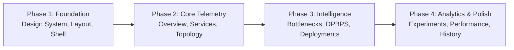

# STAGE 10.1 — FRONTEND ARCHITECTURE AUDIT AND PREMIUM UI REDESIGN PLANNING

**Project**: DPBPS — Deployment-Phase-Aware Bottleneck-Prioritized Scaling  
**Research Title**: "Design and Performance Evaluation of a CI/CD-Integrated Deployment-Aware Dynamic Scaling Approach for Microservices"  
**Repository**: `D:\CIS\Deployment Aware AAutoscaling Platform`  
**Date**: November 11, 2026  
**Status**: **AUDIT & PLANNING COMPLETE (READ-ONLY)**

---

## Executive Summary

Stage 10.1 executes a comprehensive architectural audit of the DPBPS frontend and establishes the blueprint for an enterprise-grade, highly interactive, dark-mode cloud infrastructure management interface. 

The existing frontend was developed across early research stages as a lightweight operational verification tool. While functionally capable of triggering DPBPS pipeline dry-runs and monitoring experiment status, its visual presentation, navigational hierarchy, component reusability, and interactivity do not reflect the depth, sophistication, and scientific rigor of the underlying DPBPS research platform.

This planning document establishes the technical, visual, and architectural roadmap for Stage 10, transforming the interface into a unified, publication-grade platform combining real-time Kubernetes/Prometheus telemetry, interactive call-graph dependency topologies, explainable DPBPS algorithmic intelligence, CI/CD deployment awareness, and comparative empirical analytics across all six Stage 8 workload experiments (E01–E06).

---

## 1. Current Frontend Architecture

The current frontend is structured as a client-side single-page application (SPA) scaffolded with Vite and React:

```
frontend/
├── package.json              # React 19.3.1, TypeScript 6.0.3, Vite 8.3.4, Tailwind 3.4.4
├── tailwind.config.cjs       # Custom colors (navy, charcoal, accentBlue, accentCyan)
├── postcss.config.js         # PostCSS with Tailwind & Autoprefixer
├── tsconfig.json             # Root TypeScript project references
├── tsconfig.app.json         # Browser-targeted TS compiler options
├── src/
│   ├── main.tsx              # React DOM root render
│   ├── App.tsx               # BrowserRouter & route definitions (8 routes)
│   ├── App.css / index.css   # Global styles and Tailwind base imports
│   ├── services/
│   │   └── api.ts            # Fetch-based REST client (348 LOC, typed interfaces)
│   ├── components/
│   │   ├── layout/           # AppLayout, Sidebar, TopNav
│   │   └── ui/               # MetricCard, ChartContainer, StatusBadge, Loading/Error/Empty
│   └── pages/                # 8 Page components (4 active, 4 stubs)
```

### Architectural Characteristics:
1. **Routing**: Managed by `react-router-dom` v6 with nested routes inside `AppLayout`.
2. **State Management**: Local React hooks (`useState`, `useEffect`, `useCallback`) with timed polling intervals (`setInterval` at 10 seconds). No centralized state management (Redux/Zustand) is currently used.
3. **HTTP Client**: Pure `fetch` wrappers in `frontend/src/services/api.ts` pointing to `VITE_API_BASE_URL` (defaulting to `http://localhost:8000`).
4. **Styling**: Tailwind CSS utility classes mixed with ad-hoc inline styles and light/dark color inconsistencies.

---

## 2. Current Page Inventory

An audit of the 8 page components in `frontend/src/pages/` reveals an uneven distribution of maturity:

| Page Component | Route | File Size | Maturity Level | Functional Summary & Shortcomings |
| :--- | :--- | :--- | :--- | :--- |
| **`OverviewDashboard.tsx`** | `/` | 22.2 KB (477 lines) | **Functional Prototype** | Houses health banner, deployment-phase radio selector, KPI cards, and full pipeline evaluation table. Suffers from dense layout, lack of interactive filtering, and mixed dark/light card backgrounds. |
| **`ServicesPage.tsx`** | `/services` | 5.8 KB (142 lines) | **Functional Prototype** | 3-column card grid for 10 microservices showing basic metrics and downstream dependency pills. Lacks search, sorting, time-series charts, and topology visualization. |
| **`ScalingPage.tsx`** | `/scaling` | 9.0 KB (196 lines) | **Functional Prototype** | Actuator dry-run safety banner, algorithmic parameter grid, and actuator audit table. Lacks decision history filtering, pagination, and visual timeline. |
| **`ExperimentsPage.tsx`** | `/experiments` | 26.3 KB (553 lines) | **Advanced Prototype** | Workload profile selection (E01–E06), configuration validator, safety checker, and experiment run history. Good operational logic, but lacks multi-experiment comparative analytics and interactive metric charts. |
| **`EnvironmentsPage.tsx`** | `/environments` | 1.5 KB (43 lines) | **Legacy Stub** | Basic 2-card grid showing Docker Desktop / Kubernetes status. Does not reflect live cluster topology or namespace health. |
| **`DeploymentsPage.tsx`** | `/deployments` | 271 B (11 lines) | **Empty Placeholder** | Static stub text: *"View and manage deployment events"*. No integration with `/api/v1/deployments`. |
| **`WorkloadsPage.tsx`** | `/workloads` | 287 B (11 lines) | **Empty Placeholder** | Static stub text: *"This page will display workload information"*. Redundant with `ExperimentsPage`. |
| **`SettingsPage.tsx`** | `/settings` | 263 B (10 lines) | **Empty Placeholder** | Static stub text: *"Configure application settings here"*. No configuration controls. |

---

## 3. Component Inventory

### Layout Components (`frontend/src/components/layout/`)
- **`AppLayout.tsx`**: Flex container hosting `Sidebar` (left) and `TopNav` + `<Outlet />` (right). Rigid height calculation; does not support sidebar collapse or mobile responsiveness.
- **`Sidebar.tsx`**: 64px width fixed sidebar with 8 navigation links and Lucide icons. Background is `#1a1e2c` (charcoal), but text and active states lack high-contrast visual cues.
- **`TopNav.tsx`**: Top header displaying backend connectivity status via `/api/v1/health`. Lacks quick-switch controls, cluster telemetry badges, and breadcrumb navigation.

### UI Primitives (`frontend/src/components/ui/`)
- **`MetricCard.tsx`**: Simple container with title, large text value, unit, and optional `(DEMO)` tag. Lacks sparklines, trend arrows, clickable drill-downs, and secondary context.
- **`ChartContainer.tsx`**: Box wrapper with a title and fixed 256px (`h-64`) height. Lacks interactive controls, legends, or export capabilities.
- **`StatusBadge.tsx`**: Generic pill badge for status strings (`CONNECTED`, `DISCONNECTED`, `ERROR`). Limited palette and lack of glowing/pulse indicators.
- **`LoadingState.tsx`**, **`ErrorState.tsx`**, **`EmptyState.tsx`**: Minimal text-and-spinner primitives. Functional but aesthetically basic.
- **`PageHeader.tsx`**: Simple `h1` and `p` subtitle wrapper.

---

## 4. Backend API Audit & Endpoint Mapping

A comprehensive mapping between backend routes (`backend/app/api/v1_router.py`), API client methods (`frontend/src/services/api.ts`), and proposed frontend pages:

| Proposed Page | Required Telemetry / Data | Backend Endpoint | HTTP Method | Existing Client Function | Endpoint Status |
| :--- | :--- | :--- | :--- | :--- | :--- |
| **1. Overview** | System health & invariants | `/api/v1/health` | `GET` | `fetchHealth()` | **Available** |
| | Live cluster telemetry summary | `/api/v1/kubernetes/telemetry/summary` | `GET` | `fetchTelemetrySummary()` | **Available** |
| | Real-time pipeline evaluation | `/api/v1/dpbps/pipeline/evaluate` | `GET` / `POST` | `fetchPipelineEvaluation()` | **Available** |
| | Deployment phase transition | `/api/v1/scaling/deployment-phase` | `POST` | `updateDeploymentPhase()` | **Available** |
| **2. Service Monitoring** | 10 Microservice health & metrics | `/api/v1/services` | `GET` | `fetchServices()` | **Available** |
| | Detailed pod/deployment telemetry | `/api/v1/kubernetes/telemetry` | `GET` | *(direct URL)* | **Available** |
| **3. Service Topology** | Call-graph dependency map | `/api/v1/services` (includes `dependencies`) | `GET` | `fetchServices()` | **Available** |
| | Per-service live metrics for nodes | `/api/v1/services` | `GET` | `fetchServices()` | **Available** |
| | Real-time bottleneck highlight | `/api/v1/dpbps/pipeline/evaluate` | `GET` | `fetchPipelineEvaluation()` | **Available** |
| **4. Bottleneck Analysis** | Bottleneck identification & scores | `/api/v1/dpbps/pipeline/evaluate` | `GET` | `fetchPipelineEvaluation()` | **Available** |
| | Historical bottleneck decisions | `/api/v1/scaling/decisions` | `GET` | `fetchScalingDecisions()` | **Available** |
| **5. DPBPS Intelligence** | Decision reasoning & invariants | `/api/v1/dpbps/pipeline/evaluate` | `GET` | `fetchPipelineEvaluation()` | **Available** |
| | Dry-run actuator execution results | `/api/v1/scaling/actuator/history` | `GET` | `fetchActuatorHistory()` | **Available** |
| | Decision log audit trail | `/api/v1/scaling/decisions` | `GET` | `fetchScalingDecisions()` | **Available** |
| **6. Deployment Intelligence** | Kubernetes deployment rollouts | `/api/v1/deployments` | `GET` | `fetchDeployments()` | **Available** |
| | Deployment phase state & controls | `/api/v1/scaling/status` | `GET` | `fetchScalingStatus()` | **Available** |
| **7. Experiments** | Workload profile specifications | `/api/v1/experiments/profiles` | `GET` | `fetchWorkloadProfiles()` | **Available** |
| | Experiment run inventory & status | `/api/v1/experiments` | `GET` | `fetchExperiments()` | **Available** |
| | Detailed experiment snapshots | `/api/v1/experiments/{id}/metrics` | `GET` | `fetchExperimentMetrics()` | **Available** |
| | Preflight safety checks | `/api/v1/experiments/{id}/safety-check` | `GET` | `checkExperimentSafety()` | **Available** |
| **8. Performance Analytics** | Stage 9 comparative evaluation | `/api/v1/evaluation/comparative` | `GET` | *None* | **MISSING ENDPOINT** |
| | Baseline replay metrics (HPA, CPU) | `/api/v1/evaluation/replay` | `GET` | *None* | **MISSING ENDPOINT** |
| **9. Scaling History** | Actuator execution history | `/api/v1/scaling/actuator/history` | `GET` | `fetchActuatorHistory()` | **Available** |
| | Scaled events log | `/api/v1/scaling/events` | `GET` | `fetchScalingEvents()` | **Available** |
| **10. System Config** | Algorithmic thresholds & bounds | `/api/v1/scaling/config` | `GET` / `PUT` | `fetchScalingConfig()` | **Available** |
| | Execution safety interlocks | `/api/v1/scaling/status` | `GET` | `fetchScalingStatus()` | **Available** |

### Endpoint Audit Observations:
1. **Coverage**: 9 out of 10 proposed pages have 100% complete backend API support already implemented and tested in `backend/app/api/v1_router.py`.
2. **Missing Endpoint Identified**: For **Page 8 (Performance Analytics)**, the backend executed Stage 9 comparative evaluation via offline replay scripts (`backend/scripts/run_evaluation_replay.py`), writing results to disk (`results/evaluation/plots/`). To render interactive comparative analytics dynamically in the UI rather than relying on static images, a lightweight read-only endpoint (`GET /api/v1/evaluation/summary`) will be designed to expose the 1,050 replay observations and comparative metrics.

---

## 5. Technology and Dependency Audit

### Existing Toolchain
- **React**: `^19.3.1` (Latest React 19 architecture).
- **TypeScript**: `~6.0.3` (Strict type safety, modern TS language features).
- **Vite**: `^8.3.4` (Ultra-fast HMR and Rollup build pipeline).
- **Tailwind CSS**: `^3.4.4` (Utility-first styling with PostCSS).
- **Recharts**: `^2.12.7` (Composable SVG charting library).
- **Lucide React**: `^0.416.0` (Extensive, clean icon set).

### Dependency & Capability Gaps:
1. **Topology / Dependency Graph Visualization**:
   - *Current*: No graph rendering library installed.
   - *Requirement*: Interactive call graph with nodes for the 10 microservices, directed edges with request volume, bottleneck status rings, and node selection.
   - *Recommended Approach*: Implement a **pure SVG-based layered DAG component** using deterministic hierarchical coordinates matching the Online Boutique call topology (Ingress $\to$ Orchestration $\to$ Downstream $\to$ Leaf). This avoids bulky third-party dependencies, prevents React 19 compatibility conflicts, and allows styling with Tailwind classes (glowing strokes, pulse animations, high-contrast dark-mode tooltips).
2. **Animation & Transition Support**:
   - *Current*: Standard CSS transitions.
   - *Recommendation*: Use native Tailwind CSS transition classes (`transition-all duration-200 ease-in-out`) and CSS keyframe animations for status pulses and glowing badges. No heavy external animation libraries (e.g. Framer Motion) are required.
3. **Table Controls**:
   - *Current*: Raw HTML `<table>` elements with basic Tailwind padding.
   - *Recommendation*: Create a reusable `DataTable` component with built-in client-side column sorting, search query filtering, status facet filters, and pagination.

---

## 6. Existing UI Limitations

1. **Light/Dark Mode Hybrid Clutter**:
   - The global background is dark navy (`#0a0e21`), but cards and tables in `OverviewDashboard.tsx` and `ServicesPage.tsx` use hardcoded `bg-white` and `text-gray-900`, creating jarring visual contrast and an unpolished appearance.
2. **Lack of Visual Hierarchy**:
   - Critical system invariants (e.g. `DRY_RUN`, `SCALING_ENABLED=false`) are styled with plain amber alert boxes that compete with metric data.
3. **No Service Topology**:
   - Dependencies are only shown as small text badges (`adservice`, `cartservice`) in card footers. Users cannot visually trace how request latency cascades through the system.
4. **Non-Interactive Charts**:
   - Recharts instances lack synchronized crosshairs, brush/zoom controls, custom dark-mode tooltips, and multi-service selection toggles.
5. **Stub Pages**:
   - Half of the sidebar routes (`Deployments`, `Workloads`, `Settings`, `Environments`) lead to empty or trivial stubs.
6. **No Historical vs. Live Separation**:
   - The UI does not provide a visual distinction when viewing historical experiment runs versus live Prometheus cluster telemetry.

---

## 7. Proposed Visual Design System

The redesign will implement a unified **Enterprise Dark Infrastructure** design system inspired by modern cloud observatories (Datadog, Grafana Cloud, Cloudflare Radar):

### A. Color Palette

```
Surface & Structure:
  --bg-primary:      #0b0f19   (Ultra-deep navy/graphite background)
  --bg-secondary:    #111827   (Card and panel surface)
  --bg-tertiary:     #1f2937   (Interactive hover states, table headers)
  --border-subtle:   #1f293d   (Card borders and dividers)
  --border-focus:    #3b82f6   (Active state / focus rings)

Text Hierarchy:
  --text-primary:    #f9fafb   (High-emphasis headers, active values)
  --text-secondary:  #9ca3af   (Labels, table columns, metadata)
  --text-muted:      #6b7280   (Timestamps, captions, units)

Semantic Accents:
  --cyan-accent:     #06b6d4   (Primary brand, telemetry streams)
  --blue-accent:     #3b82f6   (Interactive controls, navigation)
  --emerald-success: #10b981   (Healthy status, HOLD decisions, normal bounds)
  --amber-warning:   #f59e0b   (Degraded metrics, SCALE_DOWN, DRY_RUN indicators)
  --rose-danger:     #ef4444   (Bottlenecks, SCALE_UP triggers, errors, SLA breaches)
  --purple-intel:    #8b5cf6   (DPBPS algorithms, priority scores, rollout phases)
```

### B. Typography
- **Primary Font**: `Inter`, system-ui, sans-serif (clean readability for dense tables and KPIs).
- **Code / Metrics Font**: `JetBrains Mono`, `Fira Code`, monospace (tabular alignment of numbers, replica counts, timestamps, and service IDs).

### C. UI Primitives
- **Cards**: Deep graphite background (`bg-[#111827]`), subtle 1px border (`border-gray-800`), rounded corners (`rounded-xl`), soft dark drop-shadow.
- **KPI Cards**: Accent-colored top border highlight, animated number counters, positive/negative trend indicators, clickable drill-down affordance.
- **Status Pills**: Glowing circular dot indicator (`animate-pulse` for active processes) paired with uppercase badge text.
- **Tables**: Fixed headers, zebra-striping on hover (`hover:bg-gray-800/50`), inline metric progress bars, monospace numeric columns.

---

## 8. Interactive Feature Specification

### 1. Interactive Service Dependency Topology
- **Visualization**: Deterministic 4-tier directed acyclic graph (DAG):
  - Tier 1 (Ingress): `frontend`
  - Tier 2 (Orchestration): `checkoutservice`, `recommendationservice`
  - Tier 3 (Intermediate / Storage): `cartservice`, `redis-cart`
  - Tier 4 (Leaf Services): `adservice`, `currencyservice`, `emailservice`, `paymentservice`, `productcatalogservice`, `shippingservice`
- **Interactivity**:
  - Click node to open a flyout drawer showing real-time metrics, replica counts, and pod status.
  - Hover node to highlight upstream callers (red/amber edges) and downstream dependencies (cyan edges).
  - Dynamic bottleneck halo: Pulsing red border around services identified by DPBPS as the system bottleneck.

### 2. Explainable DPBPS Intelligence Center
- **Decision Detail Modal / Drawer**: Clicking any decision in the table opens an explainable reasoning card detailing:
  - Bottleneck contribution score ($B_s$).
  - Deployment phase weight factor ($W_{\text{phase}}$).
  - Actuator invariant verification (min/max bounds, cooldown, in-flight rollouts).
  - Step-by-step mathematical derivation of the recommended replica target.

### 3. Interactive Multi-Metric Charts
- Synchronized crosshair across CPU, Memory, Latency, and Throughput charts.
- Service filter pills allowing users to isolate 1 to 10 services on the chart canvas.
- Time window selector: `1m`, `5m`, `15m`, `30m`, `All`.
- Threshold reference lines indicating target SLA (e.g. 200ms latency) and autoscaling triggers (70% CPU).

### 4. Enterprise Data Tables
- Global text search across service names, decision reasons, and action types.
- Multi-column sorting (Service, Health, Replicas, Request Rate, P95, CPU).
- Status filtering (All, Scale Up, Scale Down, Hold, Bottleneck Only).
- Expandable rows revealing pod-level breakdown and container images.

---

## 9. Proposed Navigation Structure (10 Pages)

The revised navigation maps the complete DPBPS research scope into 10 enterprise pages:

```
[DPBPS Platform]
├── 1. Overview                 (/)             # High-level cluster health, KPIs, quick actions
├── 2. Service Monitoring       (/services)     # Live microservices metrics, health, pod counts
├── 3. Service Topology         (/topology)     # Interactive 10-node DAG dependency graph
├── 4. Bottleneck Analysis      (/bottlenecks)  # Root-cause bottleneck identification & ranking
├── 5. DPBPS Intelligence       (/intelligence) # Algorithmic decisions, priority scores, reasons
├── 6. Deployment Intelligence  (/deployments)  # CI/CD rollout phases, weights, canary tracking
├── 7. Experiments              (/experiments)  # Workload profiles (E01-E06), executor, safety
├── 8. Performance Analytics    (/analytics)    # Comparative evaluation (DPBPS vs HPA vs CPU)
├── 9. Scaling History          (/scaling)      # Dry-run actuator audit logs, invariant trail
└── 10. System Configuration    (/settings)     # Thresholds, bounds, safety interlock overrides
```

---

## 10. Page-by-Page Implementation Plan

### Page 1: Overview (`/`)
- **Top Section**: System Invariant Status Bar (Kubernetes Connected, Prometheus Ready, Dry-Run Active, Global Scaling Disabled).
- **KPI Bar**: 5 interactive cards:
  1. *Total Active Services* (10/10)
  2. *Live Cluster Throughput* (Total req/s)
  3. *P95 Cluster Latency* (Weighted ms)
  4. *Active Bottleneck* (Service name with pulse indicator)
  5. *Scaling Recommendations* (Scale Up / Scale Down / Hold counts)
- **Primary Grid**:
  - Left (60%): Live Throughput & Latency Trend chart (Recharts).
  - Right (40%): Active Deployment Phase Control Card with radio selectors (`NORMAL_OPERATION`, `ROLLING_UPDATE`, `CANARY_DEPLOYMENT`, `SCALE_TEST`).
- **Bottom Section**: Latest DPBPS Pipeline Evaluation summary table with quick-trigger evaluation button.

### Page 2: Service Monitoring (`/services`)
- **Header**: Live data freshness badge, cluster namespace selector (`online-boutique`), manual refresh button.
- **Controls**: Search input, health status filter pills, view toggle (Grid Cards vs Tabular List).
- **Service Cards / Rows**:
  - Real-time CPU & Memory utilization gauges.
  - Live Request Rate (req/s) and P95 / P50 latency.
  - Current Replicas vs Desired Replicas.
  - Error rate badge.
  - Direct link to inspect service in Topology and Bottleneck views.

### Page 3: Service Topology (`/topology`)
- **Canvas**: Full-screen dark interactive SVG call-graph representing the 10 Online Boutique microservices.
- **Visual Nodes**:
  - Service icon, name, current replicas, and status color.
  - Visual glow on services undergoing deployment updates or identified as bottlenecks.
- **Edges**: Directed arrows with animated pulse particles proportional to request volume.
- **Side Drawer**: Clicking any node opens a slide-over panel displaying real-time metrics, dependency list, and recent scaling decisions for that microservice.

### Page 4: Bottleneck Analysis (`/bottlenecks`)
- **Concept**: Dedicated page explaining *why* a service is identified as a bottleneck.
- **Visuals**:
  - Bottleneck Priority Score leaderboard ($B_s$).
  - Downstream latency amplification waterfall chart.
  - Queueing / saturation indicators (CPU saturation vs concurrency limit).
  - Bottleneck resolution timeline.

### Page 5: DPBPS Intelligence (`/intelligence`)
- **Focus**: Algorithmic explainability.
- **Components**:
  - Live Decision Stream: Real-time cards showing each decision (`SCALE_UP`, `SCALE_DOWN`, `HOLD`).
  - Algorithmic Factor Breakdown: Visual sliders showing how CPU, Memory, Latency, and Deployment Phase combined to produce the priority score.
  - Invariant Verification Panel: Proof that cooldown timers and replica bounds were respected.

### Page 6: Deployment Intelligence (`/deployments`)
- **Focus**: CI/CD integration and deployment-phase awareness.
- **Components**:
  - Active Deployment Phase controller and phase transition audit log.
  - In-flight Kubernetes deployment rollout status (revision, updated replicas, available replicas).
  - Phase Weight Matrix visualizer: Explains how DPBPS dampens scale-down during `ROLLING_UPDATE` and prioritizes canaries.

### Page 7: Experiments (`/experiments`)
- **Focus**: Stage 8 Workload Generation & Experiment Management.
- **Components**:
  - Profile Selector: Cards for E01 (Normal), E02 (Gradual), E03 (Sudden Spike), E04 (Sustained High), E05 (Decrease), E06 (Bursty).
  - Workload Shape Visualizer: Stepped concurrency curve chart for the selected profile.
  - Preflight Safety Checklist: Live verification of actuator dry-run and watchdog interlocks.
  - Experiment Execution History Table: Table of all completed runs with links to raw telemetry datasets.

### Page 8: Performance Analytics (`/analytics`)
- **Focus**: Stage 9 Comparative Evaluation (Research Outcomes).
- **Components**:
  - Policy Comparison Matrix: DPBPS vs Standard HPA vs CPU Threshold vs Static.
  - 12 Publication Charts Gallery: Embedded interactive views or high-resolution zoomable vectors of the 12 Stage 9 evaluation plots.
  - Metrics Breakdown: SLA compliance rate (P95 $< 200\text{ms}$), resource efficiency, scale action stability, and first-scale-up response time.

### Page 9: Scaling History (`/scaling`)
- **Focus**: Auditability and compliance.
- **Components**:
  - Searchable, paginated audit log of all dry-run actuator evaluations.
  - Columns: Timestamp, Service, Action, Replicas (Before $\to$ After), Invariant Verification Status, Execution Mode (`DRY_RUN`), Detailed Reason.
  - CSV / JSON export button for audit trails.

### Page 10: System Configuration (`/settings`)
- **Focus**: Platform tuning and safety inspection.
- **Components**:
  - Algorithmic Parameters: Min/Max replicas slider, CPU trigger (default 70%), Memory trigger (default 75%), Latency target (default 200ms).
  - Actuator Safety Panel: Visual representation of safety interlocks (`DRY_RUN` locked, `SCALING_ENABLED` toggle status).
  - Cluster & Prometheus Connection Settings.

---

## 11. Previously Deferred Functionality Audit

As required, this section provides an exhaustive evaluation of seven previously deferred features:

| Item | Current Status | Technical Dependencies | Frontend Impact | Research Impact | Production Requirement | Recommended Stage |
| :--- | :--- | :--- | :--- | :--- | :--- | :--- |
| **1. Post-scaling readiness verification** | **Deferred**<br>Actuator patches scale and returns immediately without awaiting pod readiness. | Kubernetes Pod Watcher, CoreV1 Pod Status API, readiness probe evaluation loop. | Adds async polling indicator and "Replicas Provisioning" badge to UI. | Low for dry-run evaluation; high for live closed-loop latency evaluation. | **Mandatory** before live scaling to avoid premature traffic shift to unready pods. | Stage 11 (Live Scaling Actuation) |
| **2. Automatic rollback** | **Deferred**<br>No automated mechanism to revert replica count if newly scaled pods fail probes. | Kubernetes Events API, Deployment Rollout status monitor, timeout watchdog. | Adds "Rollback Triggered" alert banner and event audit entry in Scaling History. | Low for synthetic workloads; essential for operational resilience. | **Mandatory** before unassisted production deployment. | Stage 11 (Live Scaling Actuation) |
| **3. CI/CD deployment webhook integration** | **Deferred**<br>Phase is changed manually in-memory via UI or curl. | FastAPI webhook endpoint (`/api/v1/webhooks/deploy`), GitHub Actions / ArgoCD webhook payload parser, HMAC signature auth. | Adds webhook URL generator, secret configuration panel, and incoming webhook activity stream. | Validates the "CI/CD-Integrated" claim in research title empirically. | **Recommended** for true automated deployment awareness. | Stage 10.2 / Stage 12 |
| **4. Persistent deployment-phase state** | **Deferred**<br>Phase is stored in Python memory; resets to `NORMAL_OPERATION` on backend restart. | SQLite, Redis, or Kubernetes ConfigMap state storage adapter. | Minimal (frontend already consumes `/api/v1/scaling/status`). | Medium (ensures long-running experiments survive backend restarts). | **Recommended** for production stability. | Stage 10.2 |
| **5. Live Kubernetes scaling** | **Deferred by Design**<br>Guarded by `SCALING_ENABLED=false` and `DRY_RUN=True`. | Cluster RBAC permissions (`apps/deployments/scale` write access), cluster capacity validation. | Live scaling toggle switch with high-security confirmation modal. | Forms the basis of live comparison against HPA. | **Mandatory** for physical microservices scaling demonstration. | Stage 11 (Live Scaling Actuation) |
| **6. Experiment execution safety** | **Implemented & Verified**<br>Triple-interlocked via watchdog timers, zero-replica loadgenerator baseline, and dry-run actuator. | Locust headless runner, Kubernetes ConfigMap mounting, dry-run actuator. | Frontend provides preflight safety check panel and emergency stop button. | Critical: prevented cluster collapse across E01–E06. | **Fully Functional** (Maintained throughout). | Stage 8 (Completed) |
| **7. Offline baseline evaluation validity** | **Implemented & Validated**<br>1,050 empirical observations replayed across 4 policies with mathematical rigor. | Trace Replay Engine (`backend/evaluation/`), empirical E01–E06 telemetry datasets. | Enables Page 8 (Performance Analytics) comparative charts. | High: provides rigorous comparative evidence for paper. | **Fully Validated** (Completed in Stage 9). | Stage 9 (Completed) |

---

## 12. Data-Integrity and Visualization Rules

To guarantee scientific and operational integrity, the redesigned frontend must strictly adhere to the following data-handling rules:

1. **Strict Data Source Segregation**:
   - Every metric card and chart must carry a clear **Data Source Indicator**:
     - `LIVE_TELEMETRY`: Real-time data from Prometheus scrape endpoints.
     - `HISTORICAL_EXPERIMENT`: Fixed empirical trace from an E01–E06 run.
     - `OFFLINE_REPLAY`: Theoretical baseline simulation outcome.
     - `DRY_RUN_DECISION`: Algorithmic recommendation with cluster modification inhibited.
2. **Freshness & Timestamps**:
   - All live views must display an ISO 8601 timestamp and elapsed time (e.g. *"Updated 3s ago"*).
   - If telemetry is older than 30 seconds, the indicator must shift to amber (`STALE`).
3. **No Silent Zero Substitution**:
   - If Prometheus returns an empty query or null value, the UI must render `N/A` or an informative warning icon, never a misleading `0.0`.
4. **Visual Differentiation of Actuator Modes**:
   - The top navigation bar must display a persistent, high-contrast `DRY_RUN (SIMULATED)` pill. If live scaling is ever enabled in the future, this must turn into a high-visibility red `LIVE_ACTUATION` badge.

---

## 13. Technical Risks & Mitigation

| Risk | Impact | Likelihood | Mitigation Strategy |
| :--- | :--- | :--- | :--- |
| **React 19 Dependency Conflicts** | Build or runtime failure if third-party graph/chart libraries lack React 19 peer dependency definitions. | Medium | Use native SVG for the service topology DAG and stick to verified compatible versions of Recharts and Lucide. |
| **Polling Overhead on Backend** | Frequent 10-node telemetry queries across multiple browser tabs overloading Prometheus. | Low | Maintain a single centralized polling hook (`useTelemetry`) with an adaptive 10s interval that pauses when browser tab is inactive. |
| **SVG Graph Scaling on Mobile** | Topology DAG unreadable or overflowing on smaller screens. | Medium | Implement responsive SVG `viewBox` coordinates with CSS horizontal scroll or collapsible tier views on viewports $< 1024\text{px}$. |
| **Recharts Performance with Dense Data** | Frame drops when rendering 500+ data points across 10 series simultaneously. | Low | Apply data downsampling or window slicing (last 60 data points) on real-time stream charts. |

---

## 14. Testing & Verification Strategy

1. **Build Verification**:
   - Run `npm run build` (`tsc -b && vite build`) to confirm zero TypeScript compilation errors or bundle issues.
2. **Linting & Code Quality**:
   - Run `npx oxlint` across all new components to enforce modern syntax and hook rules.
3. **API Integration Verification**:
   - Test all pages against both a running FastAPI backend and an offline backend state to verify graceful error and empty state handling.
4. **Visual Consistency Check**:
   - Confirm dark-mode contrast ratios meet WCAG AA standards ($> 4.5:1$ for normal text, $> 3:1$ for large headings and icons).

---

## 15. Recommended Implementation Sequence

The UI redesign will be implemented in four sequential, non-destructive phases:



1. **Phase 1: Design System & Application Shell** (Stage 10.2):
   - Update `tailwind.config.cjs` with full slate/navy/accent tokens.
   - Refactor `AppLayout.tsx`, `Sidebar.tsx` (collapsible), and `TopNav.tsx` (persistent health/dry-run indicators).
   - Create foundational UI primitives (`MetricCard`, `DataTable`, `StatusPill`, `CardContainer`).
2. **Phase 2: Live Telemetry & Interactive Topology** (Stage 10.3):
   - Rebuild `OverviewDashboard.tsx` with clean dark theme and live pipeline trigger.
   - Rebuild `ServicesPage.tsx` with multi-service search, sorting, and metric cards.
   - Build `ServiceTopologyPage.tsx` with interactive 10-node SVG DAG and detail flyout.
3. **Phase 3: DPBPS & Deployment Intelligence** (Stage 10.4):
   - Build `BottlenecksPage.tsx` and `IntelligencePage.tsx` for explainable decisions.
   - Build `DeploymentsPage.tsx` with live phase transition controls and rollout status.
4. **Phase 4: Analytics, Scaling History & System Polish** (Stage 10.5):
   - Upgrade `ExperimentsPage.tsx` with profile shapes and run comparisons.
   - Build `AnalyticsPage.tsx` featuring Stage 9 comparative evaluation charts.
   - Rebuild `ScalingPage.tsx` as a full audit log of dry-run actuator operations.
   - Build `SettingsPage.tsx` with algorithmic parameter controls.

