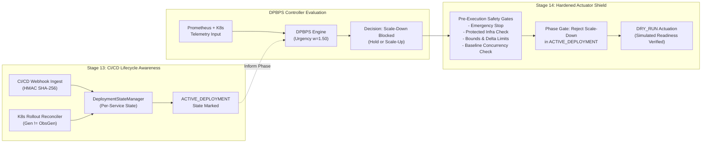

# STAGE 13 & 14 — COMBINED INTEGRATION SUMMARY
## CI/CD Deployment Awareness & Kubernetes Actuator Hardening

**Project**: Design and Performance Evaluation of a CI/CD-Integrated Deployment-Aware Dynamic Scaling Approach for Microservices  
**Algorithm**: DPBPS (Deployment-Phase-Aware Bottleneck-Prioritized Scaling)  
**Target Application**: Google Online Boutique (10 Microservices) on Kubernetes  
**Workspace Path**: `D:\CIS\Deployment Aware AAutoscaling Platform`  
**Date**: November 11, 2026  
**Status**: **PASS (All Tests Passing, Zero Live Mutations)**

---

## 1. EXECUTIVE SUMMARY

Stages 13 and 14 represent the dual defensive pillars of the DPBPS framework. Together, they bridge the critical gap between raw real-time metric telemetry (verified in Stage 11), closed-loop continuous evaluation (implemented in Stage 12), and safe, explainable Kubernetes actuation.

- **Stage 13 (CI/CD Deployment Awareness)** equips DPBPS with automated awareness of the continuous delivery lifecycle for all 10 Google Online Boutique microservices. Through HMAC SHA-256 authenticated webhook ingestion, event deduplication, and active Kubernetes rollout reconciliation, DPBPS tracks whether a service is in `NORMAL_OPERATION`, `PRE_DEPLOYMENT`, `ACTIVE_DEPLOYMENT`, or `POST_DEPLOYMENT`.
- **Stage 14 (Kubernetes Actuator Hardening)** hardens the actuator with multi-gate pre-execution safety validations, a global fail-closed **Emergency Stop** switch, transient Kubernetes API error retry handling, post-action pod readiness verification, and simulated automated rollback procedures.

Throughout both stages, the strict safety invariant **`SCALING_ENABLED=false` and `dry_run=True`** was maintained without exception. Zero live Kubernetes replica mutations occurred on the cluster.

---

## 2. HOW DEPLOYMENT AWARENESS AND ACTUATOR SAFETY WORK TOGETHER

In high-concurrency microservice architectures like Online Boutique, uncoordinated autoscaling during rolling updates causes catastrophic instability. When a deployment revision starts (e.g., updating `checkoutservice`), newly scheduled pods consume CPU initializing JVM/runtime environments while existing pods terminate. Conventional horizontal pod autoscalers (such as vanilla Kubernetes HPA) misinterpret this transient CPU surge as general load and trigger premature scale-up, or misinterpret dropping connections as low load and trigger premature scale-down, inducing cascading pod churn.

DPBPS solves this through the tight union of Stage 13 and Stage 14:



### Key Synergies
1. **Double-Lock Scale-Down Prevention**:
   - First lock in DPBPS Controller: When `service_phase == ACTIVE_DEPLOYMENT`, the controller algorithmically clamps negative replica delta to zero ($\Delta R = 0$) and explains `"Active deployment – scale-down suppressed"`.
   - Second lock in Actuator Pre-Flight Gate: Even if an erroneous scale-down decision reaches the actuator, the actuator queries `state_manager.get_phase(service_name)`. If `ACTIVE_DEPLOYMENT` or `PRE_DEPLOYMENT`, the actuator rejects the mutation with `status=REJECTED`, `validation_result="REJECTED_PHASE_RESTRICTION"`.
2. **Post-Deployment Stabilization Buffer**:
   - When Kubernetes reports that all updated pods are ready and the rollout is complete, Stage 13 automatically moves the service into `POST_DEPLOYMENT` and starts a 60-second stabilization timer.
   - Stage 14 ensures scale-down is postponed until `state_manager.is_stabilized_for_scale_down(service_name)` returns `True`, preventing premature downscaling while connection pools and caches warm up.
3. **Emergency Stop Fail-Closed Guarantee**:
   - If an anomalous traffic wave, erroneous pipeline trigger, or upstream issue occurs, operators can hit the **Emergency Stop** button on the frontend or invoke `POST /api/v1/scaling/actuator/emergency-stop`.
   - The actuator immediately locks all scaling execution (both live and dry-run) with `status=REJECTED`, logging full diagnostic audit records.

---

## 3. FULL SYSTEM INTEGRATION VERIFICATION

All layers of the DPBPS Autoscaling Platform have been tested and verified to operate cohesively:

| Component / Layer | Status | Key Verifications |
|---|---|---|
| **Prometheus & K8s Telemetry (Stage 11)** | **PASS** | Real-time metric queries, latency, error rates, CPU/memory utilization across all 10 boutique services. No fabrication of zeros for missing metrics. |
| **Continuous Controller (Stage 12)** | **PASS** | Asynchronous, non-overlapping evaluation cycles with dynamic interval cadence (15s default), bottleneck detection, and atomic JSON history. |
| **Deployment Lifecycle Manager (Stage 13)** | **PASS** | Per-service phases, HMAC SHA-256 signature verification, event deduplication, rollout progress reconciliation, and persistence across backend restarts. |
| **Kubernetes Scaling Actuator (Stage 14)** | **PASS** | Emergency stop switch, approved service allowlist, bounds/delta checks, optimistic concurrency verification, transient retries, readiness checks, and rollback design. |
| **Frontend UI Integration (Stage 10)** | **PASS** | Both `/deployments` and `/scaling` pages render live backend data, per-service rollout progress, CI/CD event streams, and emergency stop controls with confirmation dialogs. |

---

## 4. TEST SUITE SUMMARY

Across the entire backend platform, **221 tests passed**, **2 skipped** (isolated postgres database integration tests), and **0 failed**:

```
============================= test session starts =============================
platform win32 -- Python 3.11.9, pytest-8.3.2, pluggy-1.7.0
rootdir: D:\CIS\Deployment Aware AAutoscaling Platform
plugins: anyio-4.16.0
collected 223 items

backend\tests\test_actuator.py .................                         [  7%]
backend\tests\test_actuator_additional.py ..                             [  8%]
backend\tests\test_actuator_safety.py ................                   [ 15%]
backend\tests\test_api_v1_pipeline.py ..........                         [ 20%]
backend\tests\test_cicd_deployment_awareness.py .............            [ 26%]
backend\tests\test_continuous_controller.py ..............               [ 32%]
backend\tests\test_dpbps_controller.py ................                  [ 39%]
backend\tests\test_dpbps_high_traffic.py .......                         [ 42%]
backend\tests\test_evaluation_framework.py ........                      [ 46%]
backend\tests\test_hardened_actuator.py ....................             [ 55%]
backend\tests\test_kubernetes_actuator.py ...................            [ 63%]
backend\tests\test_postgres.py ..ss.                                     [ 65%]
backend\tests\test_prometheus_client.py .....................            [ 75%]
backend\tests\test_telemetry_adapter.py ..................               [ 83%]
backend\tests\test_workload_and_experiments.py ......................... [ 94%]
............                                                             [100%]

================= 221 passed, 2 skipped, 40 warnings in 7.93s =================
```

### Dedicated Stage 13 & 14 Test Results
- **Stage 13 Suite** (`test_cicd_deployment_awareness.py`): **13 / 13 PASS (100%)**
- **Stage 14 Suite** (`test_hardened_actuator.py`): **20 / 20 PASS (100%)**
- **Frontend Build & Lint**: `npm run build` passed with 0 errors (`tsc -b && vite build`), `npm run lint` passed with 0 errors.

---

## 5. CRITICAL SAFETY INVARIANTS CONFIRMATION

| Safety Invariant | Required State | Observed State | Status |
|---|---|---|---|
| `SCALING_ENABLED` | `false` | `false` | **VERIFIED** |
| Actuator Execution Mode | `DRY_RUN` (`dry_run=True`) | `DRY_RUN` | **VERIFIED** |
| Actual Live Replica Mutations | 0 mutations | 0 mutations | **VERIFIED** |
| `loadgenerator` Workload Replicas | 0/0 replicas | 0/0 replicas | **VERIFIED** |
| Experimental Datasets & Artifacts | Preserved intact | Preserved intact | **VERIFIED** |
| Git Commits / Branch Changes | None | None | **VERIFIED** |

### Live Cluster Status Verification (`kubectl get deployments -n online-boutique`)
```
NAME                     READY   UP-TO-DATE   AVAILABLE   AGE
adservice                1/1     1            1           4d5h
cartservice              1/1     1            1           4d5h
checkoutservice          1/1     1            1           4d5h
currencyservice          1/1     1            1           4d5h
emailservice             1/1     1            1           4d5h
frontend                 1/1     1            1           4d5h
loadgenerator            0/0     0            0           4d5h
opentelemetrycollector   1/1     1            1           3d4h
paymentservice           1/1     1            1           4d5h
productcatalogservice    1/1     1            1           4d5h
recommendationservice    1/1     1            1           4d5h
redis-cart               1/1     1            1           4d5h
shippingservice          1/1     1            1           4d5h
```

---

## 6. READINESS FOR STAGE 15 (CONTROLLED LIVE SCALING)

The combined implementation of Stage 13 and Stage 14 fulfills all prerequisite safety criteria for future live scaling:
1. **Defensive Pre-Flight Validation**: Actuator validates all 10 microservices, checks bounds, rejects protected infrastructure, prevents HPA fighting, and rejects concurrency conflicts.
2. **Rollout In-Progress Protection**: Scale-down operations are prevented both algorithmically and at the actuator barrier whenever a deployment rollout is active.
3. **Emergency Stop Protection**: Immediate fail-closed shutoff is accessible via UI and API.
4. **Transient Error Handling**: Bounded retries prevent transient Kubernetes network hiccups from failing operations.
5. **Readiness & Rollback Architecture**: Actuator has built-in readiness monitoring and automated rollback capabilities to safeguard microservice availability.

**Stage 15 (Controlled Live Scaling)** must only be executed upon explicit review, authorization, and formal confirmation.

