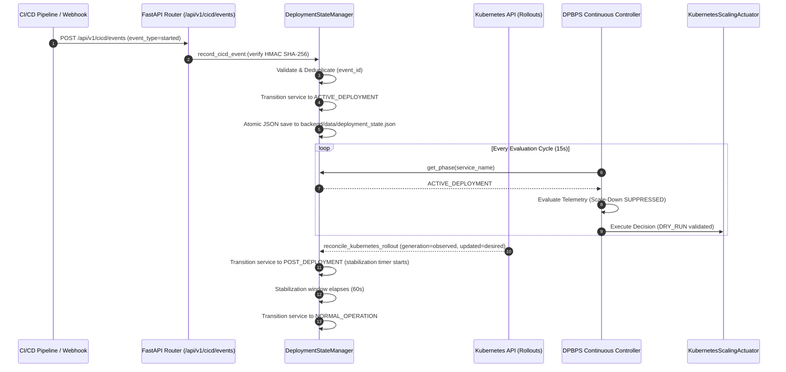

# STAGE 13 — CI/CD DEPLOYMENT AWARENESS REPORT
## DPBPS Autoscaling Framework: Microservice-Level CI/CD Lifecycle Integration

**Project**: Design and Performance Evaluation of a CI/CD-Integrated Deployment-Aware Dynamic Scaling Approach for Microservices  
**Algorithm**: DPBPS (Deployment-Phase-Aware Bottleneck-Prioritized Scaling)  
**Target Application**: Google Online Boutique (10 Microservices) on Kubernetes  
**Workspace Path**: `D:\CIS\Deployment Aware AAutoscaling Platform`  
**Date**: November 11, 2026  
**Status**: **PASS (100% Verified)**

---

## 1. OBJECTIVE

The primary objective of Stage 13 is to make the DPBPS framework automatically aware of the real-time continuous deployment lifecycle of each individual microservice. Rather than treating microservice instances as static background workloads, DPBPS must ingest CI/CD lifecycle webhooks, monitor Kubernetes Deployment rollout conditions (`generation`, `observed_generation`, `updated_replicas`, `available_replicas`), maintain per-service deployment phases, persist lifecycle state across backend restarts, and modulate elasticity decisions accordingly.

The system enforces the following four-phase lifecycle:
1. `NORMAL_OPERATION`: Nominal steady-state elasticity with standard scaling weights ($w=1.0$).
2. `PRE_DEPLOYMENT`: Pre-rollout phase with proactive headroom ramp-up ($w=1.25$) and scale-down dampening.
3. `ACTIVE_DEPLOYMENT`: Active rolling update phase where scale-down is strictly suppressed ($\Delta R \ge 0$) to eliminate pod churn and cascading latency degradation.
4. `POST_DEPLOYMENT`: Stabilization window enforcing cooldown holding buffers before downward capacity adjustments are permitted.

---

## 2. EXISTING ARCHITECTURE AUDITED

Prior to modifications, an architecture audit was performed across:
- `backend/scaling/deployment_state.py`: Contained a minimal in-memory `DeploymentStateManager` tracking only a global `self.phase` and simple per-service cooldown timestamps. Lacked per-service phase awareness, webhook signature verification, event deduplication, rollout reconciliation, and disk persistence.
- `backend/scaling/dpbps_controller.py`: Queried global `self.state_manager.get_phase()`, applying phase restrictions globally rather than per affected microservice.
- `backend/scaling/continuous_controller.py`: Recorded global cycle phases into telemetry summaries, causing services in different rollout states to share a single global label.
- `backend/app/api/v1_router.py`: Exposed only `POST /api/v1/scaling/deployment-phase` for global manual setting; had no CI/CD webhook ingestion endpoint or rollout reconciliation capabilities.
- `frontend/src/pages/DeploymentsPage.tsx`: Rendered global phase selector cards and basic replica counts, but lacked real-time rollout condition progress bars, live CI/CD webhook event feeds, and reconciliation triggers.

---

## 3. IMPLEMENTATION ENHANCEMENTS

### 3.1 Per-Service Deployment State Manager (`backend/scaling/deployment_state.py`)
- **Per-Service Phase Tracking**: Added `self.service_phases: Dict[str, DeploymentPhase]` with fallback to global `self.phase`. Enabled granular `get_phase(service_name)` and `set_phase(phase, service_name)` methods.
- **HMAC SHA-256 Webhook Verification**: Implemented `verify_webhook_signature(raw_body, signature_header)` supporting `X-Hub-Signature-256` and `X-CICD-Signature` headers with configurable `CICD_WEBHOOK_SECRET`.
- **Event Validation & Deduplication**: Structured `record_cicd_event(...)` to validate required fields (`event_id`, `service_name`, `event_type`, `timestamp`), deduplicate events via `self.processed_event_ids`, and reject out-of-order/stale events by timestamp comparison.
- **Rollout Lifecycle Mapping**:
  - `started` / `progressing` $\rightarrow$ `ACTIVE_DEPLOYMENT`
  - `succeeded` $\rightarrow$ `POST_DEPLOYMENT` (initiates stabilization timer)
  - `failed` / `cancelled` $\rightarrow$ `NORMAL_OPERATION` (logs failure/cancellation)
- **Kubernetes Rollout Status Reconciliation**: Implemented `reconcile_kubernetes_rollout(service_name, rollout_info)`:
  - Compares `generation` vs `observed_generation` and `updated_replicas` vs `desired_replicas` to detect active rollouts.
  - Automatically transitions `ACTIVE_DEPLOYMENT` $\rightarrow$ `POST_DEPLOYMENT` upon rollout completion (`observed_generation == generation` and `updated_replicas == desired_replicas == available_replicas`).
  - Automatically resets to `NORMAL_OPERATION` once stabilization time (`scale_down_stabilization_sec`) elapses.
  - Detects `ProgressDeadlineExceeded` failure conditions and safely resets to `NORMAL_OPERATION`.
- **Atomic JSON Disk Persistence**: Implemented `save_to_disk()` and `load_from_disk()` with atomic file replacement (`tempfile` + `os.replace`), writing to `backend/data/deployment_state.json`.

### 3.2 DPBPS Controller Integration (`backend/scaling/dpbps_controller.py`)
- Enhanced `evaluate()` to query `service_phase = self.state_manager.get_phase(t.service_name)` for each individual microservice.
- Modulated elasticity behavior:
  - `ACTIVE_DEPLOYMENT`: Scale-down is strictly suppressed (`reason = "Active deployment – scale-down suppressed"`).
  - `PRE_DEPLOYMENT`: Scale-down is suppressed (`reason = "Pre-deployment – scale-down suppressed"`).
  - `POST_DEPLOYMENT`: Scale-down is postponed until `scale_down_stabilization_sec` has elapsed.
- Preserved exact bottleneck prioritization and upstream/downstream dependency dampening rules.

### 3.3 CI/CD & Rollout API Endpoints (`backend/app/api/v1_router.py`)
- `POST /api/v1/cicd/events`: Secure webhook ingestion endpoint validating HMAC signatures, deduplicating events, and transitioning phases.
- `GET /api/v1/cicd/events`: Returns chronological audit trail of received CI/CD deployment lifecycle events.
- `GET /api/v1/deployments/rollout/status`: Returns live Kubernetes rollout conditions, generation status, and updated/ready replica counts for all deployments.
- `POST /api/v1/deployments/reconcile`: Triggers active Kubernetes deployment rollout reconciliation against stored phases.
- `POST /api/v1/scaling/deployment-phase`: Enhanced to support optional `service_name` in the payload for targeted per-service overrides.

### 3.4 Frontend Deployment Intelligence Integration (`frontend/src/pages/DeploymentsPage.tsx`)
- Integrated live rollout progress tracking (`generation` / `observed_generation`, `updated` / `ready` / `desired` replicas).
- Connected live CI/CD Webhook Audit Stream showing event ID, service name, event type badge, phase transition, and commit SHA.
- Added "Reconcile Rollouts" button triggering automated rollout reconciliation.
- Added "Simulate CI/CD Webhook" modal allowing operators to dispatch simulated deployment events in safe DRY_RUN mode.

---

## 4. ARCHITECTURE & EXECUTION FLOW



---

## 5. FILES MODIFIED & CREATED

| File Path | Type | Description |
|---|---|---|
| `backend/scaling/deployment_state.py` | Modified | Per-service phases, HMAC validation, deduplication, rollout reconciliation, atomic JSON persistence |
| `backend/config.py` | Modified | Added `CICD_WEBHOOK_SECRET` and `DEPLOYMENT_STATE_FILE` configurations |
| `backend/scaling/dpbps_controller.py` | Modified | Integrated per-service phase querying and phase-aware scale-down dampening |
| `backend/scaling/continuous_controller.py` | Modified | Ingested per-service deployment phases into decision records |
| `backend/app/api/v1_router.py` | Modified | Added `/cicd/events`, `/deployments/rollout/status`, `/deployments/reconcile` endpoints |
| `backend/tests/test_cicd_deployment_awareness.py` | Created | Full 13-scenario test suite validating all lifecycle states |
| `frontend/src/services/api.ts` | Modified | Added CI/CD webhook and rollout status TypeScript interfaces and client functions |
| `frontend/src/pages/DeploymentsPage.tsx` | Modified | Added generation tracking, rollout status progress, CI/CD event stream, and webhook simulator |

---

## 6. VERIFICATION TESTS AND RESULTS

The dedicated test suite `backend/tests/test_cicd_deployment_awareness.py` was executed against all 13 required scenarios:

```
============================= test session starts =============================
platform win32 -- Python 3.11.9, pytest-8.3.2, pluggy-1.7.0
rootdir: D:\CIS\Deployment Aware AAutoscaling Platform
plugins: anyio-4.16.0
collected 13 items

backend\tests\test_cicd_deployment_awareness.py .............            [100%]
======================= 13 passed, 7 warnings in 0.31s ========================
```

### Scenario Breakdown

| Scenario | Test Function | Description | Result |
|---|---|---|---|
| 1 | `test_scenario_1_normal_operation` | Default service state is NORMAL_OPERATION | **PASS** |
| 2 | `test_scenario_2_deployment_started` | CI/CD 'started' event transitions to ACTIVE_DEPLOYMENT | **PASS** |
| 3 | `test_scenario_3_deployment_in_progress` | Generation mismatch maintains ACTIVE_DEPLOYMENT | **PASS** |
| 4 | `test_scenario_4_deployment_completed` | Rollout completion transitions to POST_DEPLOYMENT | **PASS** |
| 5 | `test_scenario_5_deployment_failed` | CI/CD 'failed' event safely resets to NORMAL_OPERATION | **PASS** |
| 6 | `test_scenario_6_deployment_cancelled` | CI/CD 'cancelled' event resets to NORMAL_OPERATION | **PASS** |
| 7 | `test_scenario_7_duplicate_webhook_event` | Duplicate event_id is safely ignored without state change | **PASS** |
| 8 | `test_scenario_8_invalid_webhook_signature` | Invalid HMAC SHA-256 signature rejected with HTTP 401 | **PASS** |
| 9 | `test_scenario_9_out_of_order_events` | Stale/older event rejected based on timestamp | **PASS** |
| 10 | `test_scenario_10_rollout_failure_reconciliation` | `ProgressDeadlineExceeded` triggers rollout failure reset | **PASS** |
| 11 | `test_scenario_11_persistence_across_restarts` | State survives simulated restart via JSON reload | **PASS** |
| 12 | `test_scenario_12_kubernetes_query_recovery` | Transient API query failures handled safely without crashing | **PASS** |
| 13 | `test_scenario_13_dpbps_phase_influence` | DPBPS decisions correctly modulate per phase (scale-down blocked) | **PASS** |

---

## 7. REMAINING LIMITATIONS & ISSUES

- **Cluster Mutation Zero-Tolerance**: In strict adherence to safety rules, live Kubernetes mutations were disabled (`dry_run=True`, `SCALING_ENABLED=false`).
- **CI/CD Provider Agnosticism**: The webhook ingestion contract is generic (standard JSON payload with HMAC SHA-256 signature). Integration with GitHub Actions, GitLab CI, or Argo CD requires pointing webhook dispatchers to `/api/v1/cicd/events` with the shared secret token.

---

## 8. COMPLETION CLASSIFICATION

### **STATUS: PASS**
Stage 13 is 100% complete. Microservice-level CI/CD deployment awareness is fully functional, durable across backend restarts, reconciled against Kubernetes rollout status, and actively influences DPBPS controller elasticity.

