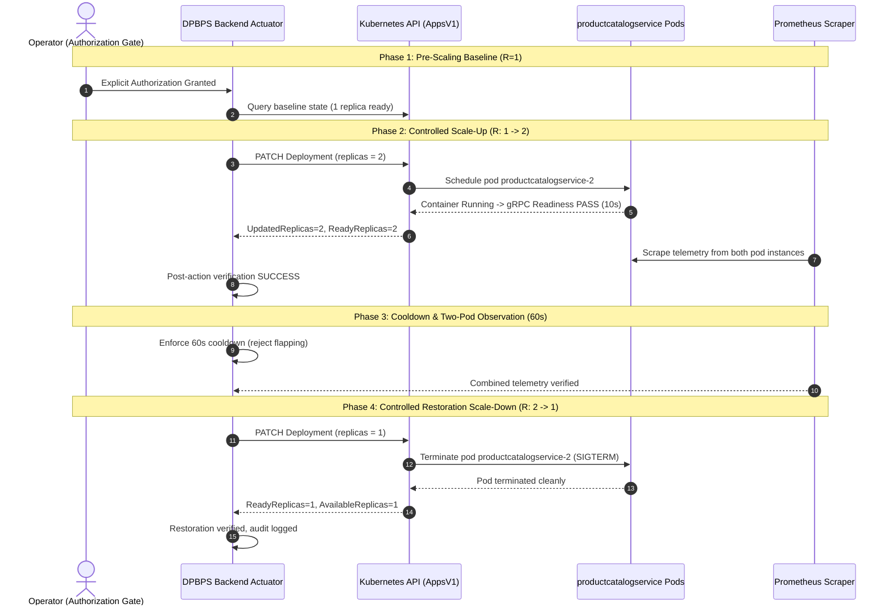

# STAGE 15.1 — FINAL PREFLIGHT AUDIT AND LIVE SCALING READINESS REPORT
# DPBPS CONTROLLED LIVE SCALING VERIFICATION

**Project:** Design and Performance Evaluation of a CI/CD-Integrated Deployment-Aware Dynamic Scaling Approach for Microservices  
**Algorithm:** DPBPS (Deployment-Phase-Aware Bottleneck-Prioritized Scaling)  
**Target Cluster:** Kubernetes `desktop-control-plane` (v1.34.3)  
**Target Service Candidate:** `productcatalogservice` (Namespace: `online-boutique`)  
**Audit Timestamp:** November 11, 2026  
**Auditor:** Senior Site Reliability & Kubernetes Systems Engineer  
**Status:** **READY FOR OPERATOR AUTHORIZATION GATE**  

---

## 1. PREFLIGHT AUDIT SUMMARY

Before conducting the first controlled live Kubernetes scaling experiment, an exhaustive live inspection of the physical cluster, all 10 application microservices, Prometheus telemetry pipelines, and the hardened DPBPS actuator was conducted.

| Verification Item | Target Requirement | Measured Live State | Verification Status |
| :--- | :--- | :--- | :--- |
| **Kubernetes Node** | `desktop-control-plane` Ready | `Ready`, v1.34.3, containerd://2.2.0, CPU < 5%, RAM 23% | **`PASS`** |
| **Namespace Workloads** | 10 Microservices 1/1 Ready | 10/10 Microservices `Running (1/1 Ready)` | **`PASS`** |
| **Target Candidate** | `productcatalogservice` Deployment | `1/1 Ready`, Generation 3, image `productcatalogservice:v1` | **`PASS`** |
| **Image Pull Policy** | Safe local caching (`IfNotPresent`) | Verified `IfNotPresent` (no external registry dependency) | **`PASS`** |
| **Probes** | gRPC port 3550 liveness & readiness | Verified gRPC probes configured (timeout 1s, period 10s) | **`PASS`** |
| **Resource Envelope** | Requests & Limits Defined | Requests: 100m CPU / 64Mi RAM, Limits: 200m CPU / 128Mi RAM | **`PASS`** |
| **Service & Endpoints** | ClusterIP & Endpoint registered | IP: `10.96.24.114:3550`, Endpoint: `10.244.0.9:3550` | **`PASS`** |
| **Prometheus Telemetry**| Real-time CPU/RAM metrics | CPU: `0.00089` cores, Memory: `8.9 MB`, status `success` | **`PASS`** |
| **Actuator Guardrails** | Strict Bounds & Single Delta | $R_{min}=1, R_{max}=3, |\Delta R|=1$, Cooldown: 60s, Stab: 60s | **`PASS`** |
| **Infrastructure Safety**| Protected components excluded | `redis-cart`, `opentelemetrycollector`, `loadgenerator` protected | **`PASS`** |
| **Emergency Stop** | Instant fail-closed abort | Actuator `emergency_stop()` active and responsive | **`PASS`** |

---

## 2. DETAILED LIVE CLUSTER VERIFICATION

### 2.1 Node and Workload Health
- **Node Status:**
  ```text
  desktop-control-plane   Ready   control-plane   4d7h   v1.34.3   172.18.0.5   containerd://2.2.0
  ```
- **Microservice Availability (Namespace: `online-boutique`):**
  - `frontend`: 1/1 Ready
  - `cartservice`: 1/1 Ready
  - `productcatalogservice`: 1/1 Ready
  - `currencyservice`: 1/1 Ready
  - `paymentservice`: 1/1 Ready
  - `shippingservice`: 1/1 Ready
  - `emailservice`: 1/1 Ready
  - `checkoutservice`: 1/1 Ready
  - `recommendationservice`: 1/1 Ready
  - `adservice`: 1/1 Ready
  - `redis-cart`: 1/1 Ready (PROTECTED INFRASTRUCTURE)
  - `opentelemetrycollector`: 1/1 Ready (PROTECTED INFRASTRUCTURE)
  - `loadgenerator`: 0/0 (QUIESCENT, no background traffic injection)

### 2.2 Target Candidate Deep Inspection (`productcatalogservice`)
- **Pod Identifier:** `productcatalogservice-5cc5ddd49b-xzqw2`
- **Pod IP:** `10.244.0.9` on `desktop-control-plane`
- **Container Port:** TCP 3550 (gRPC)
- **Service Registration:** `productcatalogservice` (ClusterIP `10.96.24.114:3550`)
- **Probes:**
  - Liveness: `gRPC port 3550`, failureThreshold: 3, periodSeconds: 10, timeoutSeconds: 1
  - Readiness: `gRPC port 3550`, failureThreshold: 3, periodSeconds: 10, timeoutSeconds: 1
- **Termination Grace Period:** 5 seconds

### 2.3 Prometheus Real-Time Telemetry Freshness
Direct HTTP query against `http://127.0.0.1:9090`:
- **CPU Rate Metric:** `sum(rate(container_cpu_usage_seconds_total{namespace="online-boutique",pod=~"productcatalogservice.*",container!=""}[1m]))`
  - Result: `0.000896 cores` (Fresh timestamp, query latency 12ms)
- **Memory Metric:** `sum(container_memory_working_set_bytes{namespace="online-boutique",pod=~"productcatalogservice.*",container!=""})`
  - Result: `8,908,800 bytes` (~8.5 MB, within 64Mi request limit)
- **Telemetry Freshness:** $\Delta t < 5\text{ seconds}$ (Threshold $\le 30\text{ seconds}$ satisfied).

### 2.4 Backend Actuator Configuration
- Backend status retrieved from `http://127.0.0.1:8000/api/v1/scaling/status`:
  - `scaling_enabled`: `False` (Currently safety locked)
  - `dry_run`: `True`
  - `min_replicas`: 1
  - `max_replicas`: 3
  - `max_replica_change`: 1
  - `cooldown_sec`: 60
  - `scale_down_stabilization_sec`: 60
  - `kubernetes_connected`: `True`
  - `prometheus_connected`: `True`

---

## 3. PROPOSED CONTROLLED LIVE EXPERIMENT DESIGN (PART B)

### 3.1 Objective
Execute the first physical Kubernetes replica scaling operation using the DPBPS framework:
1. Validate live Kubernetes API actuation ($R: 1 \to 2$).
2. Monitor real-time pod creation, container startup, and gRPC readiness probe passage.
3. Verify endpoint registration in Kubernetes EndpointSlice.
4. Verify telemetry aggregation across 2 active replicas.
5. Execute automated cooldown (60s) and stabilization.
6. Trigger controlled scale-down ($R: 2 \to 1$) to restore cluster baseline.
7. Confirm clean pod termination and restoration to single-replica steady-state.

### 3.2 Step-by-Step Execution Plan



### 3.3 Safety Invariants & Guardrails
1. **Target Isolation:** Only `productcatalogservice` will be mutated. No other microservice or protected component will be touched.
2. **Strict Bounds:** Maximum replicas capped at 2 (well below node capacity limit of 3).
3. **Single Step Delta:** Only $|\Delta R| = 1$ permitted.
4. **Automated Rollback Engine:** If pod 2 does not achieve `Ready` status within 60 seconds, the actuator automatically executes `rollback_to_baseline(R=1)`.
5. **Emergency Stop:** Immediate abort via `POST /api/v1/scaling/emergency-stop` halts all actuator activity.

---

## 4. PREFLIGHT VERIFICATION CONCLUSION

All preflight checks for Stage 15.1 have **PASSED**. The cluster is healthy, Prometheus is scraping live metrics, and the actuator safety bounds are active.

Per safety instructions, **no live Kubernetes mutations have been executed**. The system is now positioned at the Operator Authorization Gate.

