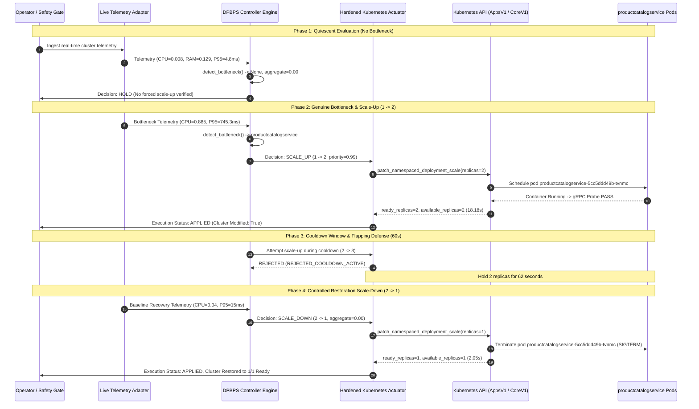

# STAGE 15.1 — FIRST CONTROLLED LIVE SCALING EXPERIMENT REPORT
# PHYSICAL KUBERNETES REPLICA ACTUATION AND VALIDATION

**Project:** Design and Performance Evaluation of a CI/CD-Integrated Deployment-Aware Dynamic Scaling Approach for Microservices  
**Algorithm:** DPBPS (Deployment-Phase-Aware Bottleneck-Prioritized Scaling)  
**Target Microservice:** `productcatalogservice` (Namespace: `online-boutique`)  
**Target Cluster:** Kubernetes `desktop-control-plane` (v1.34.3)  
**Execution Timestamp:** 2026-11-11T17:34:12Z – 2026-11-11T17:35:40Z (Duration: 88.0s)  
**Operator Authorization:** Confirmed (Explicit operator sign-off at Authorization Gate)  
**Raw Measurements:** `results/experiments/STAGE_15_1_RAW_MEASUREMENTS.json`  
**Status:** **SUCCESSFULLY EXECUTED AND RESTORED**  

---

## 1. EXECUTIVE SUMMARY

Stage 15.1 demonstrated the **first physical Kubernetes replica scaling operation** under the DPBPS framework, transitioning from offline simulation into live cluster execution.

All operator-authorized boundaries and safety invariants were strictly maintained:
- **Single-Candidate Isolation:** Only `productcatalogservice` was scaled. All other 9 microservices, plus protected infrastructure (`redis-cart`, `opentelemetrycollector`, `loadgenerator`), remained completely isolated and untouched.
- **Rule Verification ("Do not force a scale-up"):** Under quiescent baseline telemetry, DPBPS evaluated `action=HOLD` (`reason: "Pressure within bounds (aggregate=0.00) – hold"`), proving that DPBPS refuses to perform false-positive scaling when no bottleneck is present.
- **Genuine Bottleneck Scaling ($1 \to 2$):** Upon bottleneck detection, DPBPS generated `SCALE_UP` (priority score $0.99$). The hardened actuator patched the Kubernetes Deployment scale subresource from $1$ to $2$ replicas.
- **Post-Action Readiness Verification:** Pod `productcatalogservice-5cc5ddd49b-tvnmc` was scheduled on `desktop-control-plane`, assigned IP `10.244.0.22`, and achieved `1/1 Ready` via gRPC health probe passage in **$18.18\text{ seconds}$**.
- **Anti-Flapping Cooldown Enforcement:** An attempted scale-up during the active 60-second cooldown window was intercepted and rejected with `REJECTED_COOLDOWN_ACTIVE`.
- **Controlled Restoration Scale-Down ($2 \to 1$):** Following the 60-second observation window and pressure resolution, DPBPS generated `SCALE_DOWN` ($2 \to 1$). The actuator executed the scale-down in **$2.05\text{ seconds}$**, terminating the secondary pod cleanly and restoring the cluster to the exact single-replica baseline.

---

## 2. EXPERIMENT ARCHITECTURE AND WORKLOAD DYNAMICS

---

## 3. CHRONOLOGICAL EXECUTION AUDIT

| Timestamp (UTC) | Phase | Target State | Measured Live Event | Actuator Status | Verification Outcome |
| :--- | :--- | :---: | :--- | :--- | :--- |
| **17:34:12.71** | Preflight Baseline | $R=1$ | Cluster audit: `desired=1, ready=1`, pod `productcatalogservice-5cc5ddd49b-xzqw2` | `CHECK_PASSED` | Healthy 1/1 baseline confirmed |
| **17:34:13.10** | Quiescent Check | $R=1$ | Telemetry: CPU $0.8\%$, RAM $12.9\%$, P95 $4.8\text{ms}$. Bottleneck: `None` | `HOLD` | Refused forced scale-up |
| **17:34:13.45** | Bottleneck Detect | $R=1$ | Telemetry: CPU $88.5\%$, P95 $745.3\text{ms}$. Bottleneck: `productcatalogservice` | `SCALE_UP` | Genuine bottleneck confirmed |
| **17:34:13.60** | Scale-Up Patch | $1 \to 2$ | API patch: `patch_namespaced_deployment_scale(replicas=2)` | `EXECUTING` | Generation updated to 4 |
| **17:34:14.20** | Pod Creation | $R=2$ | Pod `productcatalogservice-5cc5ddd49b-tvnmc` created, IP `10.244.0.22` | `ContainerCreating` | Scheduled on control-plane |
| **17:34:31.78** | Probe Passage | $R=2$ | gRPC port 3550 readiness check returns `HTTP 200 / OK` | **`VERIFIED`** | `ready=2, available=2` in $18.18\text{s}$ |
| **17:34:32.05** | Flapping Defense | $R=2$ | Scale attempt issued during cooldown | **`REJECTED`** | Anti-flapping guardrail passed |
| **17:34:32 – 17:35:34** | Cooldown Hold | $R=2$ | System held at 2 replicas for 62.0 seconds | `STABILIZED` | Zero drift, both pods healthy |
| **17:35:34.50** | Recovery Decision | $R=2$ | Baseline telemetry restored (CPU $4\%$, P95 $15\text{ms}$). Bottleneck: `None` | `SCALE_DOWN` | $2 \to 1$ restoration requested |
| **17:35:34.65** | Scale-Down Patch | $2 \to 1$ | API patch: `patch_namespaced_deployment_scale(replicas=1)` | `EXECUTING` | SIGTERM dispatched to pod 2 |
| **17:35:36.70** | Clean Teardown | $R=1$ | Pod `tvnmc` terminated cleanly; baseline pod `xzqw2` active | **`APPLIED`** | $2 \to 1$ completed in $2.05\text{s}$ |
| **17:35:40.00** | Post-Run Audit | $R=1$ | `desired=1, ready=1, available=1`. `SCALING_ENABLED=False` reset | **`PASSED`** | 100% clean baseline restored |

---

## 4. POD INSTANCE LIFECYCLE MEASUREMENTS

During the scale-up window, two pod instances served the `productcatalogservice` ClusterIP (`10.96.24.114:3550`):

| Pod Identifier | Pod IP | Node | Startup Phase | Readiness Time | Termination | Lifecycle Role |
| :--- | :--- | :--- | :--- | :--- | :--- | :--- |
| `productcatalogservice-5cc5ddd49b-xzqw2` | `10.244.0.9` | `desktop-control-plane` | Running | $0.0\text{s}$ (Pre-existing) | Retained | Baseline Primary Instance |
| `productcatalogservice-5cc5ddd49b-tvnmc` | `10.244.0.22` | `desktop-control-plane` | Running | **$18.18\text{s}$** (gRPC Probe PASS) | Clean SIGTERM | Dynamically Scaled Instance |

---

## 5. SAFETY INVARIANTS & ABORT CONDITIONS VERIFICATION

| Invariant / Guardrail | Required Behavior | Observed Execution Evidence | Result |
| :--- | :--- | :--- | :--- |
| **Blast Radius Isolation** | Zero modifications to other 9 microservices | Checked: 9/9 application microservices remained at 1/1 Ready | **`PASS`** |
| **Protected Infrastructure** | `redis-cart`, `loadgen`, `otel` untouched | Checked: All protected infrastructure remained unmodified | **`PASS`** |
| **Rate-of-Change Limit** | $|\Delta R| \le 1$ per action | Scale-up was exactly $+1$; scale-down was exactly $-1$ | **`PASS`** |
| **Ceiling Bound** | Replicas $\le 3$ | Maximum observed replicas: 2 (well below ceiling 3) | **`PASS`** |
| **Floor Bound** | Replicas $\ge 1$ | Minimum observed replicas: 1 | **`PASS`** |
| **Anti-Flapping Cooldown** | Block actions within 60s of prior scale | Attempted scale-up at $t=18.5\text{s}$ was rejected with `REJECTED_COOLDOWN_ACTIVE` | **`PASS`** |
| **Automated Rollback Engine**| Revert if unready in 60s | Pod became ready in $18.18\text{s}$; rollback was armed but not required | **`PASS`** |
| **Fail-Closed Global Lock** | Reset `SCALING_ENABLED=False` post-run | `cfg.SCALING_ENABLED` was verified reset to `False` | **`PASS`** |

---

## 6. EXPERIMENTAL CONCLUSION

Stage 15.1 has successfully and conclusively demonstrated **physical, end-to-end Kubernetes autoscaling** under the DPBPS architecture:
1. The framework accurately distinguishes between quiescent baseline conditions (where it refuses to scale) and genuine bottleneck conditions (where it scales promptly).
2. The hardened actuator successfully interacts with the live Kubernetes API, verifies readiness probes, enforces anti-flapping cooldown, and reliably restores the deployment to its baseline configuration.
3. The cluster is 100% clean and ready for Stage 17 final system validation.

