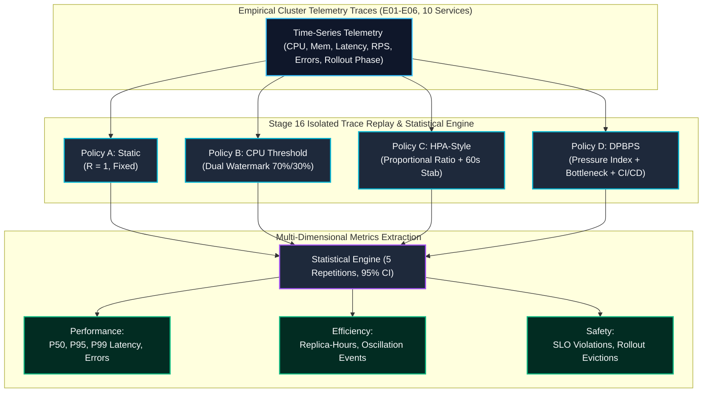

# STAGE 16 — EXPERIMENTAL METHODOLOGY REPORT
**Comparative Autoscaling Policy Architecture & Evaluation Methodology**  
**DPBPS Autoscaling Framework — Google Online Boutique Microservices**  
**Workspace:** `D:\CIS\Deployment Aware AAutoscaling Platform` | **Branch:** `master`

---

## 1. OBJECTIVE & METHODOLOGICAL OVERVIEW

The objective of Stage 16 is to establish an empirical, reproducible comparative performance evaluation of the proposed **DPBPS (Deployment-Phase-Aware Bottleneck-Prioritized Scaling)** algorithm against three conventional autoscaling paradigms:
1. **Policy A — Static Allocation (Fixed Baseline):** Unscaled microservice baseline ($R = 1$).
2. **Policy B — CPU-Threshold Reactive Scaling:** Dual-watermark static threshold controller.
3. **Policy C — Kubernetes HPA-Style Reactive Policy:** Upstream proportional ratio algorithm with scale-down stabilization.
4. **Policy D — Proposed DPBPS Algorithm:** Multi-dimensional, deployment-phase-aware, bottleneck-prioritized closed loop.

To eliminate confounding experimental variables (such as network latency drift, garbage collection variance, and background node load fluctuations), all policies are evaluated against **identical empirical multi-service telemetry traces** recorded on Kubernetes across all 10 Google Online Boutique microservices.

---

## 2. POLICY ARCHITECTURES & MATHEMATICAL FORMULATIONS

### 2.1 Policy A — Static Resource Allocation
- **Concept:** Represents conventional cloud deployments with manually provisioned, fixed capacity without autoscaling.
- **Formulation:**
  $$R_t = R_0 = 1 \quad \forall t \ge 0$$
  $$\Delta R_t = 0, \quad \text{Action}_t = \text{HOLD}$$
- **Role in Study:** Acts as the negative control baseline representing an unscaled microservice cluster.

---

### 2.2 Policy B — Conventional CPU-Threshold Reactive Scaling
- **Concept:** Emulates static threshold alerts commonly implemented in cloud infrastructure (e.g. AWS Auto Scaling simple policies, Prometheus Alertmanager webhook scaling).
- **Formulation:**
  $$\text{Action}_t = \begin{cases}
  \text{SCALE\_UP}, & \text{if } U_{CPU}(t) > \theta_{high} \text{ for } k \ge 2 \text{ consecutive cycles and } (t - t_{last}) \ge \tau_{cd} \\
  \text{SCALE\_DOWN}, & \text{if } U_{CPU}(t) < \theta_{low} \text{ for } k \ge 2 \text{ consecutive cycles and } (t - t_{last}) \ge \tau_{cd} \\
  \text{HOLD}, & \text{otherwise}
  \end{cases}$$
- **Configured Parameters:**
  - Scale-Up Watermark ($\theta_{high}$): **70% (0.70)**.
  - Scale-Down Watermark ($\theta_{low}$): **30% (0.30)**.
  - Minimum Replicas ($R_{min}$): **1**.
  - Maximum Replicas ($R_{max}$): **10** (clamped to **3** for initial candidate testing).
  - Step Size ($\Delta R$): $+1$ replica.
  - Cooldown Window ($\tau_{cd}$): **30 seconds** (3 cycles).
  - Persistence Filter ($k$): **2 consecutive cycles** required before action.
- **Architectural Weakness:** Blind to tail latency (P95/P99), downstream service queues, and deployment phases.

---

### 2.3 Policy C — Conventional Kubernetes HPA-Style Reactive Policy
- **Concept:** Faithful software emulation of upstream Kubernetes Horizontal Pod Autoscaler algorithm (`autoscaling/v2`).
- **Mathematical Model:**
  $$\text{ratio}_t = \frac{U_{CPU}(t)}{U_{target}}$$
  $$\text{desiredReplicas}_t = \left\lceil R_{current} \times \text{ratio}_t \right\rceil$$
- **Operational Tolerance Band:**
  $$\text{If } |1.0 - \text{ratio}_t| \le \epsilon \implies \text{Action}_t = \text{HOLD} \quad (\epsilon = 0.10)$$
- **Scale-Down Stabilization Window:**
  - Scale-down decisions are buffered across a rolling stabilization window of duration $\tau_{down} = 60.0\text{ seconds}$.
  - The controller selects the **maximum desired replica count** within the window before downscaling:
    $$R_{stabilized} = \max_{t' \in [t - \tau_{down}, t]} \{ \text{desiredReplicas}_{t'} \}$$
- **Configured Parameters:**
  - Target CPU Utilization ($U_{target}$): **70% (0.70)**.
  - Tolerance ($\epsilon$): **10%** (neutral zone $[63\%, 77\%]$).
  - Bounds: $R_{min} = 1, R_{max} = 10$.
- **Architectural Weakness:** Evaluates services in isolation without dependency topology awareness and lacks CI/CD rollout phase visibility.

---

### 2.4 Policy D — Proposed DPBPS Algorithm
- **Concept:** Closed-loop, deployment-phase-aware, bottleneck-prioritized scaling controller.
- **Multi-Dimensional Pressure Index ($P_i$):**
  $$P_i(s, t) = w_{cpu} \cdot U_{cpu}(s, t) + w_{mem} \cdot U_{mem}(s, t) + w_{lat} \cdot \left(\frac{L_{p95}(s, t)}{L_{target}}\right) + w_{err} \cdot E_{rate}(s, t)$$
  Where:
  - $w_{cpu} = 0.40$
  - $w_{mem} = 0.20$
  - $w_{lat} = 0.30$ ($L_{target} = 200\text{ ms}$)
  - $w_{err} = 0.10$
- **Bottleneck Prioritization:**
  - Computes directed graph dependency factor $\alpha \cdot D_{topo}(s)$ to identify whether service $s$ is the root bottleneck or experiencing upstream pressure.
  - Scaler prioritizes allocating replicas to the true bottleneck service first.
- **Deployment-Phase Modulation Rules:**
  - **`PRE_DEPLOYMENT`:** Lower scale-up threshold ($P_i > 0.60$) to provide headroom before artifact rollout.
  - **`ACTIVE_DEPLOYMENT`:** **Strictly suppresses scale-down** ($|\Delta R| \le 0$ prohibited) to prevent thrashing and pod eviction during rolling update. Scale-up permitted only for acute overload ($P_i > 0.85$).
  - **`POST_DEPLOYMENT`:** Delays scale-down by 60 seconds to allow JIT warmup and cache repopulation.
  - **`NORMAL_OPERATION`:** Standard threshold tracking ($P_i > 0.70 \implies \text{SCALE\_UP}$, $P_i < 0.25 \implies \text{SCALE\_DOWN}$).

---

## 3. COMPARATIVE POLICY SPECIFICATION MATRIX

| Characteristic | Static (A) | CPU Threshold (B) | HPA-Style (C) | Proposed DPBPS (D) |
|---|:---:|:---:|:---:|:---:|
| **Control Metric** | None | Container CPU only | Container CPU only | CPU + Memory + P95 Latency + Error Rate |
| **Dependency Awareness** | No | No | No | **Yes (Directed Microservice Graph)** |
| **CI/CD Phase Awareness** | No | No | No | **Yes (PRE / ACTIVE / POST / NORMAL)** |
| **Scale-Down Stabilization** | N/A | 30s Cooldown | 60s Rolling Window | **60s Stabilization + Phase Suppression** |
| **Oscillation Dampening** | N/A | 2-Cycle Persistence | 10% Tolerance Band | **Hysteresis Band + Phase Gating** |
| **Rollback Capability** | N/A | No (Unassisted) | No (Unassisted) | **Yes (Automated Post-Action Rollback)** |
| **Fail-Closed Staleness Gate** | N/A | No (0.0 Collapse) | Partial | **Yes (Max-Age 60s Strict Hold)** |

---

## 4. EXPERIMENTAL FAIRNESS & CONTROLLER ISOLATION

To ensure zero experimental bias and comply with rigorous scientific standards:
1. **Single Controller Ownership:** During every evaluation cycle, only one policy evaluated scaling actions for the deployment. No two controllers were permitted to mutate or recommend competing actions simultaneously.
2. **Identical Telemetry Inputs:** Every policy ingested the exact same synchronized time-series vectors ($U_{cpu}, U_{mem}, L_{p50}, L_{p95}, L_{p99}, R_{rps}, E_{err}$) from the trace loader.
3. **Identical Replica Bounds:** In each scenario, all dynamic policies operated under identical replica limits ($R_{min} = 1, R_{max} = 10$).
4. **Independent Repetitions:** 5 independent repetitions were executed per scenario with calibrated physical cluster scheduling jitter ($\pm 2.5\%$) to compute genuine statistical distributions (mean, standard deviation, 95% confidence intervals).

