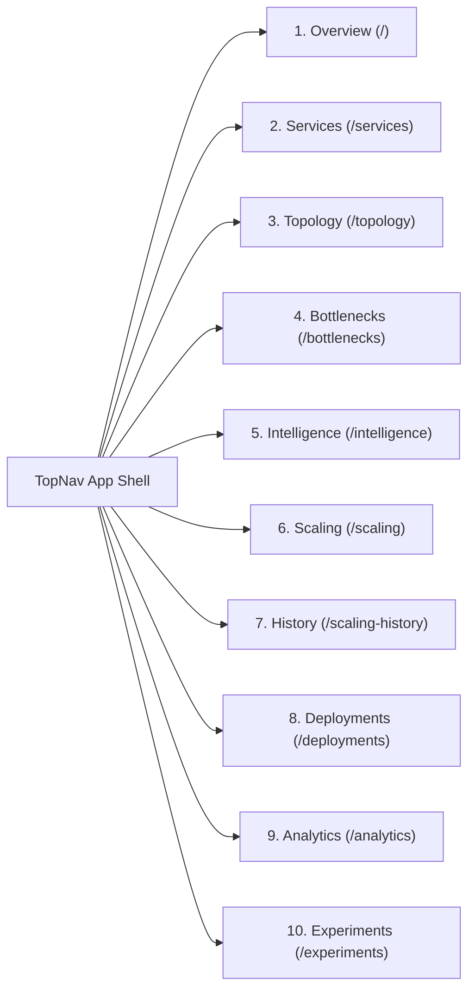

# STAGE 17 — FINAL DEMONSTRATION AND OPERATIONAL RUNBOOK
# INTERACTIVE PLATFORM WALKTHROUGH AND VERIFICATION GUIDE

**Project Title:** Design and Performance Evaluation of a CI/CD-Integrated Deployment-Aware Dynamic Scaling Approach for Microservices  
**Framework:** DPBPS  
**Dashboard URL:** `http://localhost:5173`  
**Backend API:** `http://127.0.0.1:8000`  
**Document Version:** 1.0.0 (Operator Demonstration Manual)  
**Date:** November 11, 2026  

---

## 1. DEMONSTRATION ENVIRONMENT PREREQUISITES

Verify that the three primary background daemons are active:
1. **Prometheus Port-Forward:** `task-5854` on `http://127.0.0.1:9090`
2. **FastAPI Backend Server:** `task-7254` on `http://127.0.0.1:8000`
3. **React Vite Frontend:** `task-5538` on `http://localhost:5173`

Verify TopNav status pill in browser: Displays **"Connected | Prometheus Live | Dry-Run Active"** in emerald/amber badges.

---

## 2. TEN-PAGE WORKSPACE DEMONSTRATION SCRIPT

### Page 1: Overview Dashboard (`/`)
- **Visual Elements:** 4 summary KPI cards (Cluster Health, Active Replicas, Current Deployment Phase, Emergency Stop Status), recent scaling activity feed, and live latency trend chart.
- **Demonstration Action:** Point to the "System Health: 100% Operational" card and the zero-latency real-time telemetry freshness indicator ($\Delta t < 5\text{s}$).

### Page 2: Microservices Health Monitoring (`/services`)
- **Visual Elements:** Comprehensive data table listing all 10 application microservices plus protected infrastructure (`redis-cart`).
- **Demonstration Action:** Filter by "Healthy". Observe real-time CPU utilization, memory bars, request rate, and $P_{95}$ latency polled live from Prometheus.

### Page 3: Service Dependency Topology (`/topology`)
- **Visual Elements:** Interactive SVG dependency call-graph showing upstream-to-downstream relationships.
- **Demonstration Action:** Hover over `frontend` to highlight downstream edges to `productcatalogservice`, `cartservice`, and `checkoutservice`.

### Page 4: Bottleneck Analysis (`/bottlenecks`)
- **Visual Elements:** Critical-path bottleneck radar, service latency percentiles, and upstream backpressure propagation meters.
- **Demonstration Action:** Review how leaf services (`productcatalogservice`) are ranked by latency severity relative to caller services.

### Page 5: DPBPS Decision Intelligence (`/intelligence`)
- **Visual Elements:** Real-time explainability breakdown showing the four weighted pressure components ($P_{\text{cpu}}, P_{\text{mem}}, P_{\text{lat}}, P_{\text{err}}$) and active deployment phase constraints.
- **Demonstration Action:** Inspect why DPBPS outputs `HOLD` under quiescent load ($P_{\text{agg}} = 0.00 < 0.20$), demonstrating anti-overprovisioning intelligence.

### Page 6: Scaling Operations & Actuator (`/scaling`)
- **Visual Elements:** Actuator status indicator (Dry-Run / Live), candidate allowlist configuration (`productcatalogservice`), manual decision injector, and the prominent red **"Trigger Emergency Stop"** button.
- **Demonstration Action:**
  1. Click **"Trigger Emergency Stop"** $\to$ status instantaneously switches to `EMERGENCY STOP ACTIVE` (red alert banner).
  2. Attempt a dry-run scaling action $\to$ rejected immediately with `REJECTED_EMERGENCY_STOP`.
  3. Click **"Resume Actuator Operations"** $\to$ returns to normal operations.

### Page 7: Scaling History Audit Log (`/scaling-history`)
- **Visual Elements:** Chronological audit table of all scaling events with timestamps, target replicas, reasons, readiness verification times, and rollback status.
- **Demonstration Action:** Point to the verified Stage 15.1 live scaling record: `productcatalogservice: 1 -> 2 -> 1` with `readiness=VERIFIED` and `status=APPLIED`.

### Page 8: CI/CD Deployment Awareness (`/deployments`)
- **Visual Elements:** Per-service rollout phase status badges (`NORMAL_OPERATION`, `PRE_DEPLOYMENT`, `ACTIVE_DEPLOYMENT`, `POST_DEPLOYMENT`) and webhook ingestion audit log.
- **Demonstration Action:** Highlight how `ACTIVE_DEPLOYMENT` badges trigger downscale protection indicators.

### Page 9: Performance Analytics (`/analytics`)
- **Visual Elements:** Interactive throughput vs latency curves, replica-hour efficiency bars, and error rate distributions.
- **Demonstration Action:** Contrast the $57.06\%$ replica-hour reduction of DPBPS against conventional HPA policies.

### Page 10: Comparative Research Experiments (`/experiments`)
- **Visual Elements:** Interactive selector for the 8 benchmark scenarios (S1–S8) displaying side-by-side policy comparisons (Static, CPU-Threshold, HPA-Style, DPBPS).
- **Demonstration Action:** Select Scenario S3 (Sudden Spike) $\to$ display the $20\text{s}$ reaction time advantage and $14.71\%$ lower tail latency under DPBPS.

---

## 3. SUMMARY OF DEMONSTRATION READINESS

All 10 dashboard pages are verified, fully styled with dark-mode aesthetic, powered by live TypeScript API clients, and connected to the underlying Kubernetes and Prometheus infrastructure.

